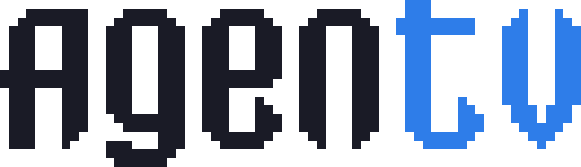

  <picture>
    <source media="(prefers-color-scheme: dark)" srcset="../branding/logo.svg">
    
  </picture>

  <b>The world's first open-source agentic TV OS.</b> 
  Powered by <a href="https://omarchy.org">Omarchy</a>.

---

AgenTV is a TV OS for a little x86 box under your TV. Tested on an Intel NUC.

I wanted a TV I could just talk to. Sit down, say "continue the show I was watching" into your phone, and it knows which app that was.

And when it's missing an app, you shouldn't have to wait for someone to write one. Ask it to add a streaming service or a game and its agent goes off and builds the app: finds it, writes the integration and tests it.

It'll install from a USB stick. You answer Omarchy's usual installer questions and finish the rest from your phone. A companion app is coming soon too: remote, keyboard and microphone in one.

Not there yet, though. Phase 1 is being built right now, so there's nothing to install. Watch the repo if you want to know when there is.

## Powered by Omarchy

AgenTV is an Omarchy variant. It installs [Omarchy](https://omarchy.org) 4 and adds a TV session of its own beside Omarchy's desktop. The box logs in to the TV. When you need the full desktop, you switch over to Omarchy's and back.

- **This repo** is a fork of [omacom/omarchy](https://github.com/omacom/omarchy) that follows Omarchy's stable releases.
- **Omarchy's files are never edited here.** AgenTV only adds its own, under `install/tv/`, `session/`, `daemon/`, `launcher/`, `setup/`, `builder/`, `apps/`, `branding/` and `bin/agentv`.
- **Omarchy's own README** is [`../README.md`](../README.md).
- **Omarchy is made by David Heinemeier Hansson and its contributors.** It is MIT-licensed, and its [licence](../LICENSE) is kept as it is. AgenTV's additions use the same licence.
- **Not official:** AgenTV isn't made or endorsed by the Omarchy project.

The AgenTV wordmark is drawn in the letterforms of Omarchy's logo, as a thank-you, and its "a" is Omarchy's own. `branding/build.py` makes every logo file from one set of letters.

## The AgenTV repos

| Repo | What it is |
| --- | --- |
| `agentv-os` (this one) | The TV OS: Omarchy plus AgenTV's TV session, the daemon, the launcher, setup, the builder and the app contract |
| [`agentv-iso`](https://github.com/radomird/agentv-iso) | The installer ISO, a fork of `omacom/omarchy-iso` that installs `agentv-os` |
| `agentv-index` | The signed index of apps (coming soon) |
| `agentv-app-*` | Official apps: Jellyfin, Plex, Immich, Steam (coming soon) |
| `agentv-plugin` | An Omarchy shell plugin with a "Back to TV" button for the desktop (coming soon) |
| `agentv-companion` | The phone app: remote, keyboard and microphone (coming soon) |
