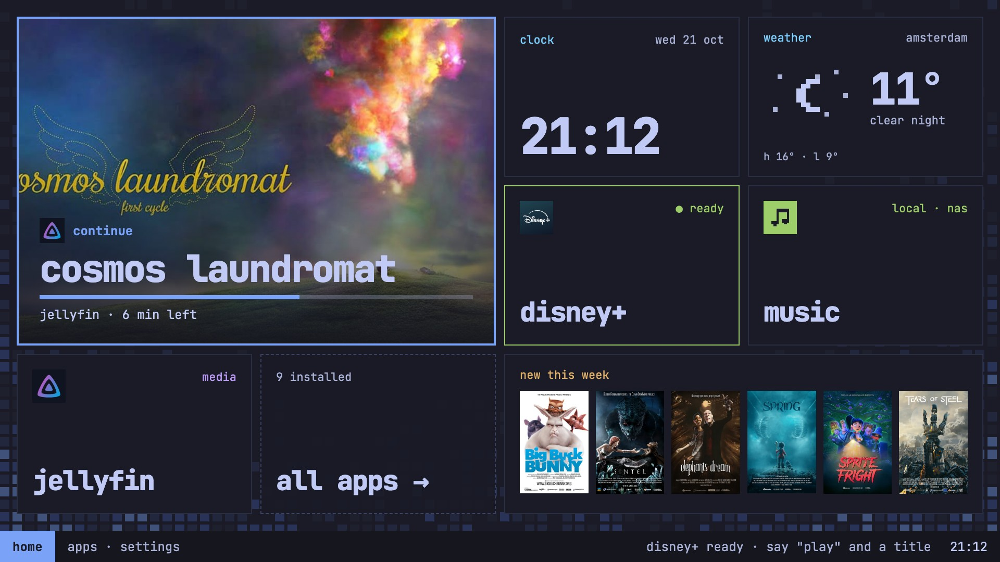
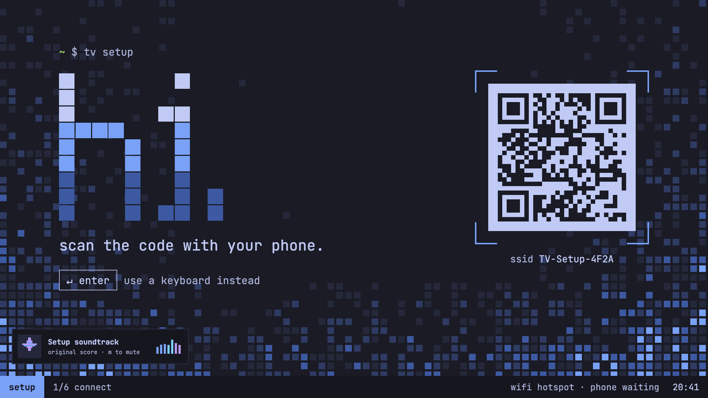
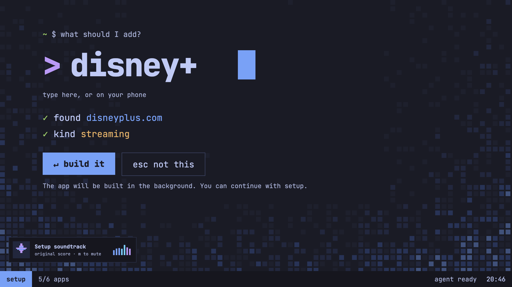
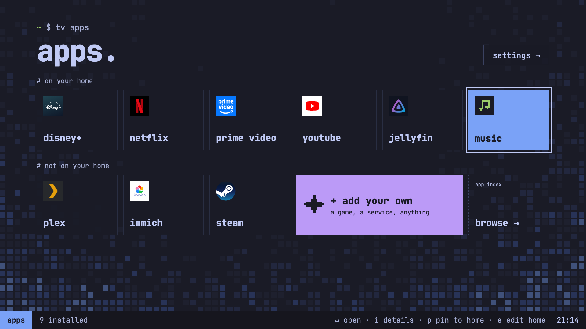
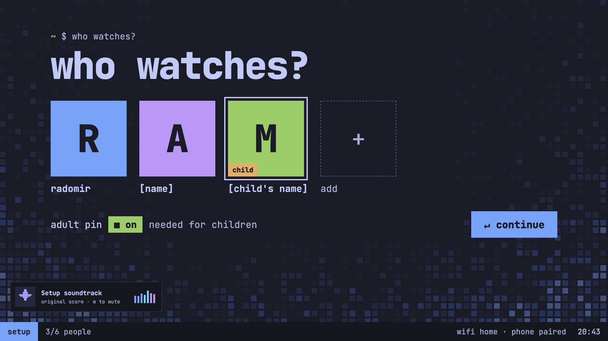
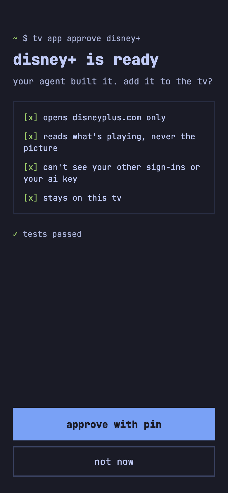
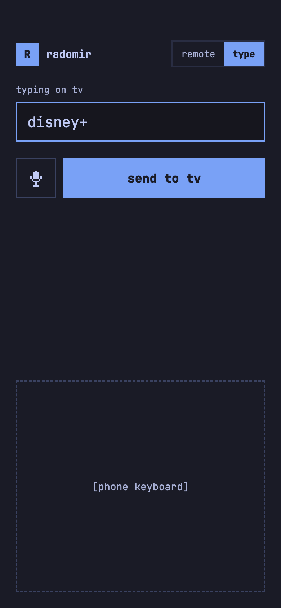
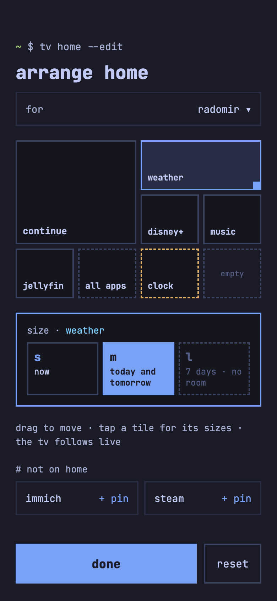

  <picture>
    <source media="(prefers-color-scheme: dark)" srcset="../branding/logo.svg">
    
  </picture>

  <b>The world's first open-source agentic TV OS.</b> 
  Powered by <a href="https://omarchy.org">Omarchy</a>.

  

---

AgenTV is the OS for a little box under your TV. Think of it as an Apple TV you own all the way down: one box, your phone as the remote, apps from a signed index, and a profile for everyone in the house.

It works with any TV that has HDMI. AgenTV runs on the box, not the TV, so it doesn't care whether your TV is a Samsung, an LG or a Sony, or what OS it came with. A projector or an old monitor is fine too.

I wanted a TV I could just talk to. Sit down, say "continue the show I was watching" into your phone, and it knows which app that was.

And when it's missing an app, you shouldn't have to wait for someone to write one. Ask for a streaming service or a game, and AgenTV's own agent will build the app on your box and test it. That part is coming soon.

Underneath it's Omarchy, so the full Linux desktop is one switch away.

## What's in 0.1.3

[0.1.3](https://github.com/radomird/agentv-os/releases/tag/v0.1.3) is a pre-release, tested on an Intel NUC.

- **Your phone is the remote.** Scan the code on the TV and your phone's browser becomes the remote and the keyboard, with no app to install. It follows the TV: a PIN pad when the TV asks for the PIN, the keyboard for search, play and pause when something's on.
- **Continue** on home picks up what you were watching.
- **Your own media.** Music plays your own files, USB drives and shares on your network. Jellyfin and Immich put your server's films and photos on the TV.
- **Steam Big Picture** runs full screen, and a game keeps running behind home.
- **Profiles for adults and children,** with the apps each child can see ticked by an adult. An adult PIN guards Settings, installs and Omarchy's desktop.
- **Settings from the couch.** Restart, shut down, the sound output and its volume, and your AI provider.
- **Signed updates.** The box only takes packages signed with AgenTV's key, and every release installs, boots and updates itself in a VM before you see it.

## Coming soon

- **An agent that builds the apps you're missing.** A streaming service, a game, a better weather app. It follows a recipe for each kind of app, builds it inside AgenTV's app contract and tests it. The app stays on your box unless you export it.
- **"Play" and a title,** said into your phone, across every app you have. It'll work with Claude, ChatGPT, Gemini, Grok or Muse Code.
- **TV setup from your phone,** from "hi." to home.
- **Every Omarchy theme on the TV,** with the theme's own backgrounds, or your photos and open art archives instead. Omarchy's terminal screensaver comes along too.
- **Share anything to the TV** from your phone: a link, a photo or a video.
- **An iPhone app:** remote, keyboard and microphone in one.

| | |
| --- | --- |
|  |  |
|  |  |

  
  
  

These are AgenTV's design screens, the reference the TV is built to match, so some of what they show is coming soon. The posters and stills are from the Blender Foundation's open movies ([studio.blender.org](https://studio.blender.org), CC BY). Jellyfin's logo is the Jellyfin project's (CC BY-SA 4.0), and the other logos are their owners' (see [Trademarks](#trademarks)).

## Install

You'll need:

- an x86_64 box with HDMI (mine's an Intel NUC8i5BEH);
- a USB stick of 8 GB or more;
- a keyboard, for Omarchy's installer.

1. Download [the 0.1.3 ISO](https://pub-18fa48b004b845838c98225b8955c7e6.r2.dev/iso/agentv-0.1.3-x86_64.iso) (about 6.5 GB) and [its checksum](https://pub-18fa48b004b845838c98225b8955c7e6.r2.dev/iso/agentv-0.1.3-x86_64.iso.sha256). Each [agentv-iso release](https://github.com/radomird/agentv-iso/releases) links to its own. With both in one folder, `shasum -a 256 -c agentv-0.1.3-x86_64.iso.sha256` on a Mac (or `sha256sum -c` on Linux) checks the download.
2. Write it to the stick with [balenaEtcher](https://etcher.balena.io/) on a Mac or Windows, or [caligula](https://github.com/ifd3f/caligula) on Linux, like [Omarchy's manual](../manual/02-getting-started.md) says.
3. Boot the box from the stick and answer Omarchy's usual installer questions. It wipes the box's disk.
4. The box reboots into AgenTV. TV setup is coming soon, so for now a new box starts on a welcome page, and `agentv setup skip` takes it to home.
5. Pair your phone in Settings → Phones.

### Tested boxes

| Box | Release | How it went |
| --- | --- | --- |
| Intel NUC8i5BEH | 0.1.3 | Works. It's the box AgenTV is built on. |

Tried it on another box? [Tell me how it went](https://github.com/radomird/agentv-os/issues/new?template=box-report.yml) and I'll add it here.

## Questions

**Will it work with my TV?** If it has an HDMI input, yes. The TV only shows the picture and plays the sound, so its brand and its own OS don't matter.

**How is it different from OmarchyTV?** [OmarchyTV](https://github.com/piermark/omarchytv) by Marco Porro is a home screen in Omarchy's style for the TV you already have, on Android TV, Google TV and LG webOS. AgenTV is a whole OS on a box of its own, so it doesn't depend on what your TV runs. They'd get along fine: OmarchyTV on the TV, AgenTV on one of its HDMI inputs.

**Will streaming services play in 4K?** Not yet. They play in Chromium, and on Linux that means HD at best, with no HDR.

**Do I need an AI subscription?** Only for the agent and for "play": a key from one of the providers above, or a plan where its terms allow it. The rest works without one.

## Powered by Omarchy

AgenTV is an Omarchy variant. It installs [Omarchy](https://omarchy.org) 4 and adds a TV session of its own beside Omarchy's desktop. The box logs in to the TV. When you need the full desktop, you switch over to Omarchy's and back.

- **This repo** is a fork of [omacom/omarchy](https://github.com/omacom/omarchy) that follows Omarchy's stable releases.
- **Omarchy's files are never edited here.** AgenTV only adds its own, under `install/tv/`, `session/`, `daemon/`, `launcher/`, `setup/`, `builder/`, `apps/`, `branding/` and `bin/agentv`.
- **Omarchy's own README** is [`../README.md`](../README.md).
- **Omarchy is made by David Heinemeier Hansson and its contributors.** It's MIT-licensed, and its [licence](../LICENSE) is kept as it is. AgenTV's additions use the same licence.
- **Not official:** AgenTV isn't made or endorsed by the Omarchy project.

The AgenTV wordmark is drawn in the letterforms of Omarchy's logo, as a thank-you, and its "a" is Omarchy's own. `branding/build.py` makes every logo file from one set of letters.

## The AgenTV repos

| Repo | What it is |
| --- | --- |
| `agentv-os` (this one) | The TV OS: Omarchy plus AgenTV's TV session, the daemon, the launcher, setup, the builder and the app contract |
| [`agentv-iso`](https://github.com/radomird/agentv-iso) | The installer ISO, a fork of `omacom/omarchy-iso` that installs `agentv-os` |
| [`agentv-pkgs`](https://github.com/radomird/agentv-pkgs) | The `agentv` and `agentv-keyring` packages, and the signed repository a box updates from |
| [`agentv-apps`](https://github.com/radomird/agentv-apps) | The official apps, one folder each, and the signed index a box installs them from: Jellyfin, Immich, Steam and Plex |
| `agentv-plugin` | An Omarchy shell plugin with a "Back to TV" button for the desktop (coming soon) |
| `agentv-companion` | The iPhone app: remote, keyboard and microphone (coming soon) |

## Trademarks

Apple TV, Disney+, Netflix, Prime Video, YouTube, Steam, Jellyfin, Immich, Plex, Samsung, LG and Sony are trademarks of their owners. They're named or shown here only to say which TVs and apps AgenTV works with. AgenTV isn't made or endorsed by any of them, and this repo has no code for Disney+, Netflix or Prime Video.
