

  <picture>
    <source media="(prefers-color-scheme: dark)" srcset="../branding/logo.svg">
    
  </picture>

  <b>The world's first open-source agentic TV OS.</b> 
  Powered by <a href="https://omarchy.org">Omarchy</a>.

  <a href="#install-it">Install it</a> · <a href="#what-you-get">What you get</a> · <a href="#questions">Questions</a>

  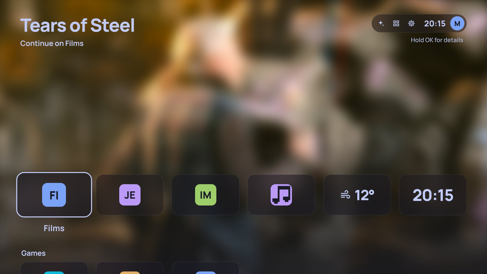

---

AgenTV turns a small PC into the box under your TV.

**It's easy, like an Apple TV.** Your phone is the remote. Home has what you were watching. Everyone in the house gets a profile, children too.

**It's yours to change.** Pick how home looks, how big things are, the colours and the background. And when an app is missing, you don't wait for someone to write it. You ask for it, and your TV makes it. That's the agentic part.

**It's good for games.** Steam runs full screen for the games you own. Or ask for a small game of your own, and it's on home when it's done.

It works with any TV that has HDMI, because AgenTV runs on the box and not on the TV. A projector or an old monitor works too.

I built it because I wanted a TV I could just ask for things, and one I could change without waiting for anyone.

## What you get

### Easy to use

- **Your phone is the remote.** Scan the code on the TV and that's it. There's no app to install. Swipe to move, tap for OK, and Back, Home and Play stay in the same place.
- **Type on your phone, see it on the TV.** When the TV needs words, your phone's keyboard comes up by itself, and the TV shows each letter as you type it.
- **Pick up where you stopped.** Home has what you were watching, one press away.
- **Just ask.** "Play Sintel." "Continue my show." "What's new this week?" Type it or say it into your phone, and the answer shows on the TV.
- **A profile for everyone.** An adult picks which apps each child sees. Set an adult PIN and it guards the grown-up things: adding apps, updates, your AI and the Linux desktop.
- **Setup from the couch.** It runs on your phone, from the first screen to home. On the way it looks at your box and tells you what it's good for, in a line or two.
- **Settings from the couch too.** Wi-Fi, sound, game controllers and updates are all there, and your phone types the passwords.
- **Hold OK on an app** to see who made it and what it connects to, or to quit it.

  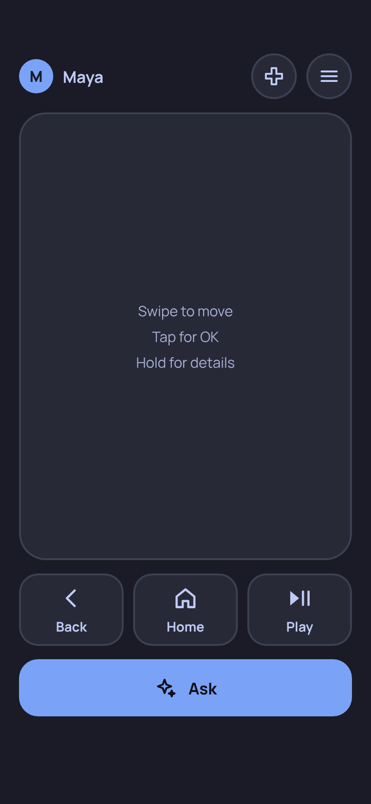
  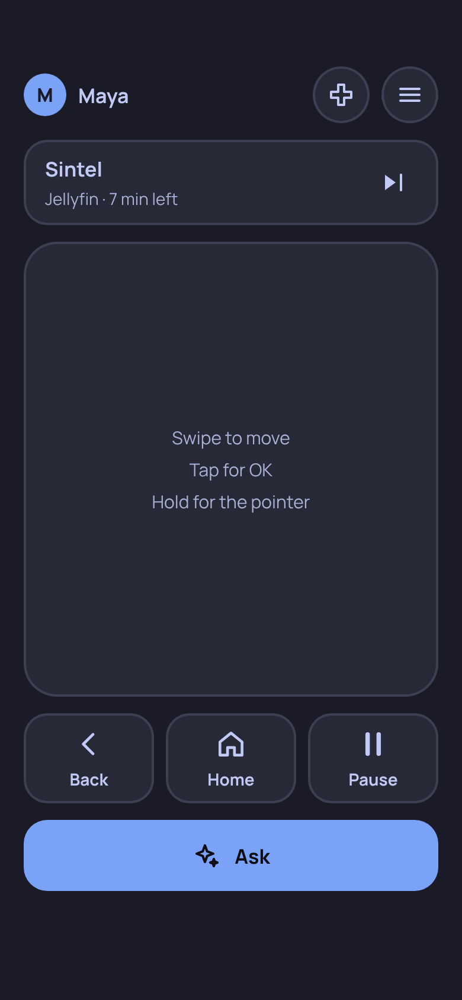
  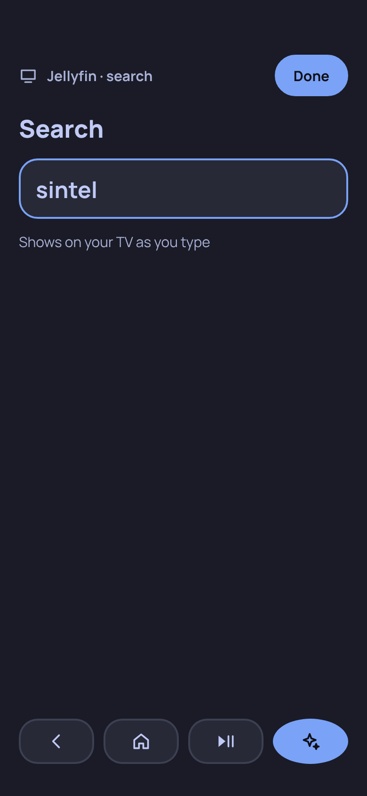

### Yours to change

- **Three looks for home.** Terminal is tiles like windows, in a mono font. Glass puts frosted tiles over a big picture from one of your apps. Cinema has something to watch up top, then rows of your apps and shows. Change it whenever you like in _Settings > Appearance_.
- **Three sizes,** so it reads well from your couch. A 4K TV gets all three, and a 1080p TV gets two.
- **Every Omarchy theme,** with its backgrounds, the moving ones too. Or use your own photos, or art from museums' open archives.
- **A screen saver** that shows those pictures when the TV's idle.
- **Build your own.** Can't find an app? Ask for it: a puzzle game, a better weather page, a slideshow of your photos. Your TV makes it while you keep watching, then puts it on home.
- **Keep changing it.** Anything you made has "Change it". Say what you'd like different.
- **What you make is yours.** It stays on your TV unless you save a copy.
- **Edit home from your phone.** Put the apps you use first.

| | | |
| --- | --- | --- |
| 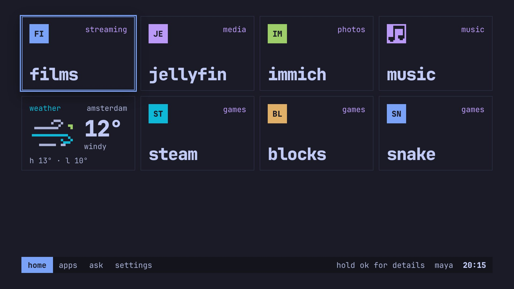 | 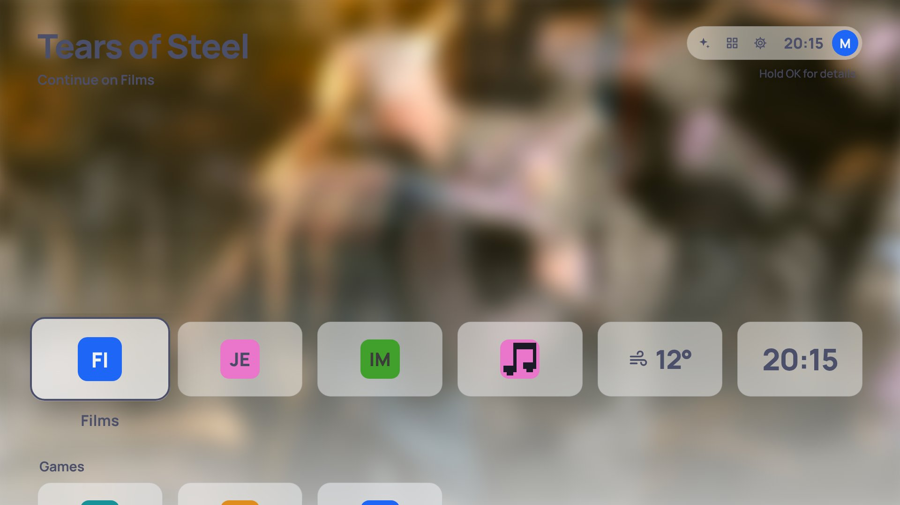 | 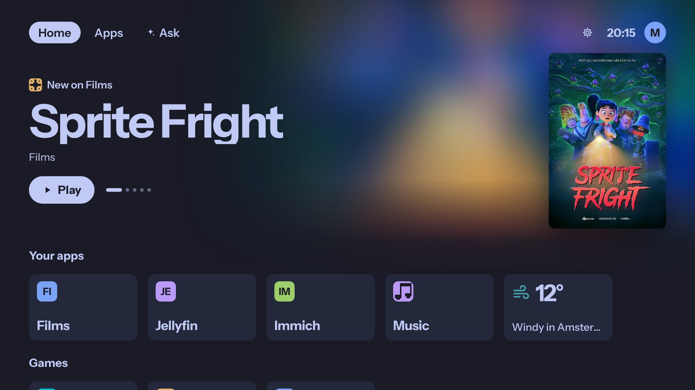 |

<i>Terminal, Glass and Cinema. Each one follows your theme.</i>

  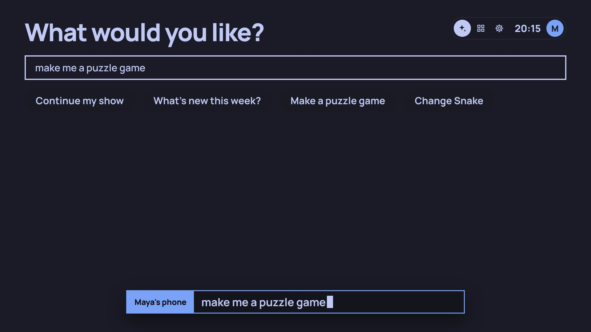
  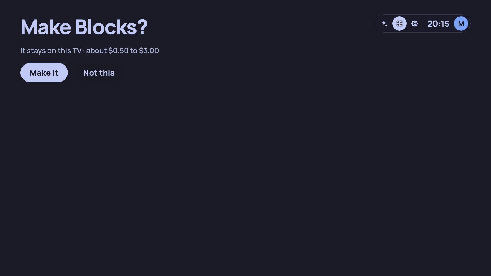

### Good for games

- **Steam, full screen,** in Big Picture. Go back to home and your game keeps running.
- **Games you ask for.** "Make me a puzzle game."
- **A place for games on home.** In Glass and Cinema it's a row named Games, with Steam and the games you've made. In Terminal each game is a tile of its own.
- **Controllers.** Pair a Bluetooth controller in _Settings > Phones and controllers_. Hold its guide button to get from a game back to home.
- **You'll know what your box can play.** Setup says it plainly. My little NUC gets "light games".

### Your shows, films, photos and music

- **Six streaming apps,** three now and three coming soon. You sign in from your phone, on the service's own page. [The list is in agentv-apps](https://github.com/radomird/agentv-apps#what-you-get).
- **Your own servers.** Jellyfin, Plex and Immich show up in a list, found on your network, with no address to type. So do shared folders on a network drive.
- **Music** from your own files: on the box, a USB drive or a network folder.
- **New this week** on the apps you have, and whether your show has a new episode yet. It needs a key from your own TMDB account.
- **Send to the TV** from your phone: a link, a photo or a video.

## Before you install

A few things I'd want to know first:

- **Streaming won't be 4K.** The TV's own screens are, on a 4K TV. But the streaming apps play in a browser on Linux, and the services hold that to somewhere between SD and 1080p, with no HDR. If an app only plays in SD, [its entry in agentv-apps](https://github.com/radomird/agentv-apps#what-you-get) says so.
- **Asking and making need an AI you already pay for.** Sign in with your Claude, ChatGPT or Grok plan during setup. Or add an API key: Claude, ChatGPT, Gemini, Grok and Muse all take one. Everything else works without an AI.
- **It has no voice of its own.** Answers show on the TV. If you add an API key for an AI that has a voice (ChatGPT, Gemini or Grok), it says them too.
- **I've tested it on one box,** mine. It should run on other x86_64 PCs, and I'd love to hear how it goes on yours.
- **Installing erases the disk you pick.**

## Install it

You'll need:

- an x86_64 PC with HDMI (mine's an Intel NUC8i5BEH)
- a USB stick of 8 GB or more
- your phone
- a keyboard, just long enough to tell the box to start from the stick

1. Download the ISO from the newest release on [agentv-iso's releases page](https://github.com/radomird/agentv-iso/releases). Its notes have the download link. The file is named after its version, like `agentv-1.0.0-x86_64.iso`, and it's about 6.7 GB. Want to be sure the download is mine? [agentv-iso's README](https://github.com/radomird/agentv-iso#getting-the-iso) has the four commands that check it.
2. Write it to the stick with [balenaEtcher](https://etcher.balena.io/) on a Mac or Windows, or [caligula](https://github.com/ifd3f/caligula) on Linux.
3. Start the box from the stick. On my NUC that's F10 as it powers on. Omarchy needs Secure Boot off, so turn it off in your box's firmware first if it's on. [Omarchy's manual](../manual/02-getting-started.md) has more on that.
4. The TV shows a code. Scan it with your phone, pick the disk and tap "Erase and install". No phone to hand? Pick the disk with the keyboard and press Enter.
5. The box installs, restarts by itself and comes up on the TV. Your phone carries on with setup from there.
6. Want another phone on it later? Pair it in _Settings > Phones and controllers_. Scan the code if you can. It's the safer way to pair, because the code you scan holds a longer secret than the six characters you'd type.

Want every question Omarchy's own installer asks (your keyboard layout, disk encryption, your own account name)? Press Ctrl+C on the first screen.

After that:

- **Updates** are in _Settings > System > Updates_. See what's new, install it now or let it install overnight. If an update goes wrong, you can go back to the version before.
- **The Linux desktop** is Omarchy's, and it's still there. Super+Ctrl+Home takes you to it and back.
- **Start setup again** with `agentv setup reset`. Your profiles, phones and PIN stay.

  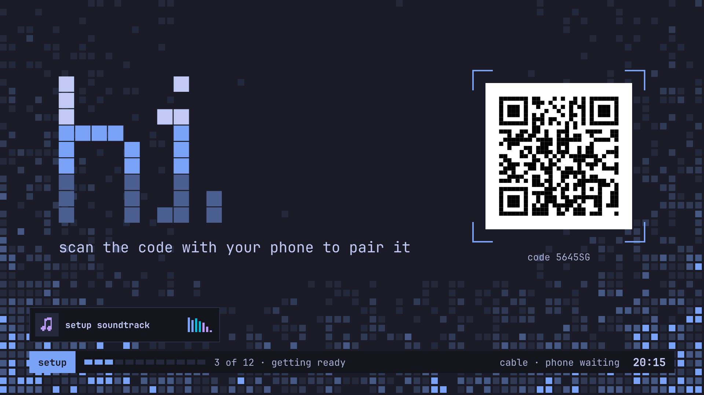
  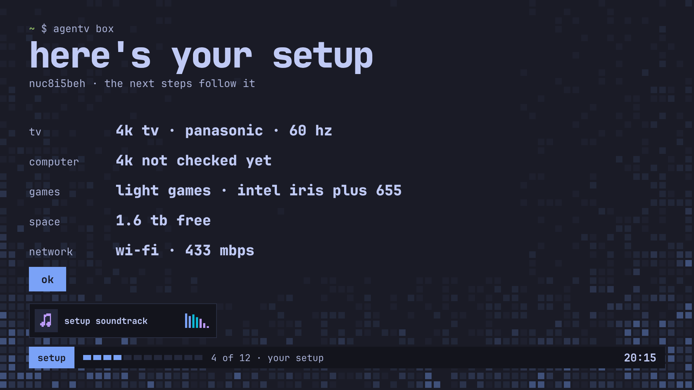

### Tested boxes

| Box | Release | How it went |
| --- | --- | --- |
| Intel NUC8i5BEH, on a 4K TV | 1.0 | It's the box I build AgenTV on. Home is in 4K, and setup says "light games". |

Tried it on another box? [Tell me how it went](https://github.com/radomird/agentv-os/issues/new?template=box-report.yml) and I'll add it here.

## Questions

**Will it work with my TV?** If it has an HDMI input, yes. The TV only shows the picture and plays the sound, so its brand and its own software don't matter.

**Do I need an AI subscription?** Only to ask for things and to make apps. The remote, your apps, profiles and everything else work without one.

**Which streaming services does it have?** Six: three now, and three coming soon. The list, and what each app can do, is in [agentv-apps](https://github.com/radomird/agentv-apps#what-you-get).

**Does it run on a Raspberry Pi?** No. It needs an x86_64 PC.

**Can I still use it as a computer?** Yes. Omarchy's whole desktop is there, behind your PIN if you set one.

**How is it different from OmarchyTV?** [OmarchyTV](https://github.com/piermark/omarchytv) by Marco Porro is a home screen in Omarchy's style for the TV you already have, on Android TV, Google TV and LG webOS. AgenTV is a whole OS on a box of its own, so it doesn't depend on what your TV runs. They'd get along fine: OmarchyTV on the TV, AgenTV on one of its HDMI inputs.

**Something's broken. Where do I say so?** [Open an issue](https://github.com/radomird/agentv-os/issues/new/choose). For a security problem, please [tell me privately](https://github.com/radomird/agentv-os/security/advisories/new) first.

## Coming soon

- **An iPhone app:** the remote, the keyboard and a microphone in one. Until then, every phone uses its browser.
- **A place to share the apps you've made,** and to find other people's.

## Support AgenTV

AgenTV is free and open source. If it's useful to you and you'd like to help, you can [chip in through Stripe](https://buy.stripe.com/7sY4gzeMjdZs1oo7Wbgfu00) and pick the amount yourself. The checkout will say Indie AI Labs: that's where I build it.

A star helps too, and so does [telling me how it ran on your box](https://github.com/radomird/agentv-os/issues/new?template=box-report.yml).

## How it works

For the curious, and for anyone poking around the code.

AgenTV is Omarchy with a TV session next to its desktop. Your box starts straight into the TV. A small server on the box runs home, the remote, profiles and your apps, and your phone talks to it over your own network.

The part that makes apps is the AI you already use, working on your box through its own coding tool. It knows how to make a few kinds of app (a game, a page, a slideshow of your photos, a theme). Every app follows the same small set of rules, so they all work with the remote, with profiles and with Continue.

Your box only installs packages signed with AgenTV's key. The apps that come with AgenTV install from a list signed with the same key. And before a release reaches you, it installs, boots and updates itself in a VM.

Where things are:

| Folder | What's in it |
| --- | --- |
| `session/` | The TV's own session |
| `daemon/` | The server on the box |
| `launcher/` | Home, Apps and Settings, in three looks |
| `setup/` | TV setup |
| `companion-web/` | The phone remote |
| `builder/` | What makes apps |
| `apps/` | The rules every app follows, and the built-in apps |
| `install/tv/`, `bin/agentv*` | The installer's TV part, and the `agentv` command |

`bin/agentv-check` and `test/agentv/unit/run` are the quick checks.

The repos:

| Repo | What it is |
| --- | --- |
| `agentv-os` (this one) | The TV OS itself |
| [`agentv-iso`](https://github.com/radomird/agentv-iso) | The USB installer |
| [`agentv-apps`](https://github.com/radomird/agentv-apps) | The apps that come with it |
| [`agentv-pkgs`](https://github.com/radomird/agentv-pkgs) | The packages your box updates from |

## Powered by Omarchy

AgenTV is an Omarchy variant. It installs [Omarchy](https://omarchy.org) 4.5 and adds its own TV session next to Omarchy's desktop.

This repo is a fork of [omacom/omarchy](https://github.com/omacom/omarchy) that follows Omarchy's stable releases. I don't edit Omarchy's own files here, with one exception: the security policy and the issue forms are AgenTV's, so a report about AgenTV reaches me and not Omarchy. Everything AgenTV adds lives in the folders above. Omarchy's own README is still here, at [`../README.md`](../README.md).

Omarchy is made by David Heinemeier Hansson and its contributors. It's MIT-licensed, and its [licence](../LICENSE) stays as it is. AgenTV's additions are copyright Radomir Drndarski and use the same licence, with two exceptions. The [menu sounds](../launcher/sounds/LICENSE) and the [setup music](../setup/audio/LICENSE) are all rights reserved and ship only with AgenTV. The fonts keep their own [open licence](../launcher/fonts/OFL.txt). AgenTV isn't made or endorsed by the Omarchy project.

The AgenTV wordmark is drawn in the letters of Omarchy's logo, as a thank-you, and its "a" is Omarchy's own.

The films in the pictures are the Blender Foundation's open movies ([studio.blender.org](https://studio.blender.org), CC BY).

## Whose names these are

Apple TV, Steam, Jellyfin, Immich and Plex are trademarks of their owners. So are the AI products named above, and the names and logos of the [streaming apps](https://github.com/radomird/agentv-apps#what-you-get). I only name them to say what AgenTV works with or is like. AgenTV isn't made or endorsed by any of them, and the code for the streaming apps is in `agentv-apps`, not in this repo.
