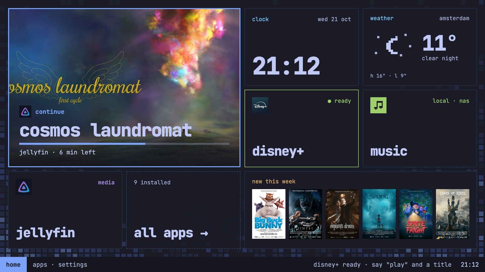
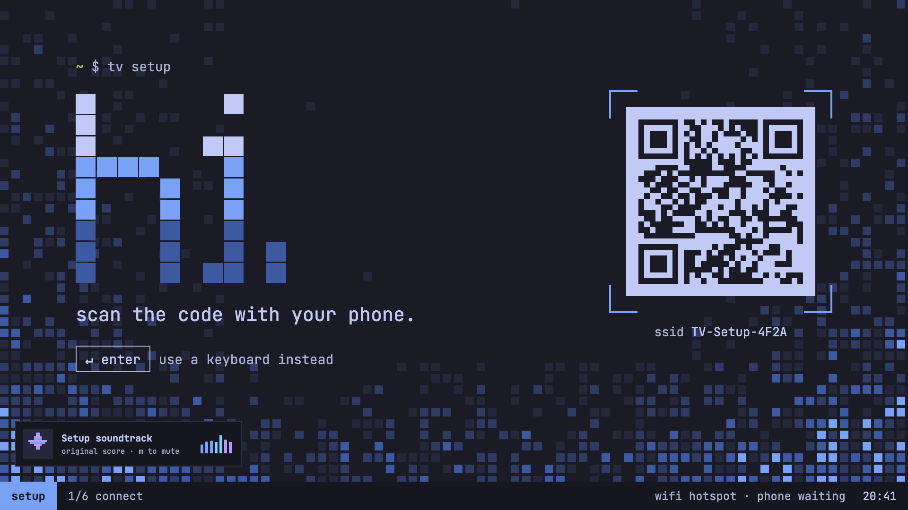
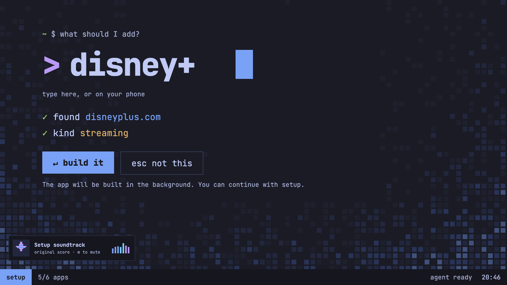
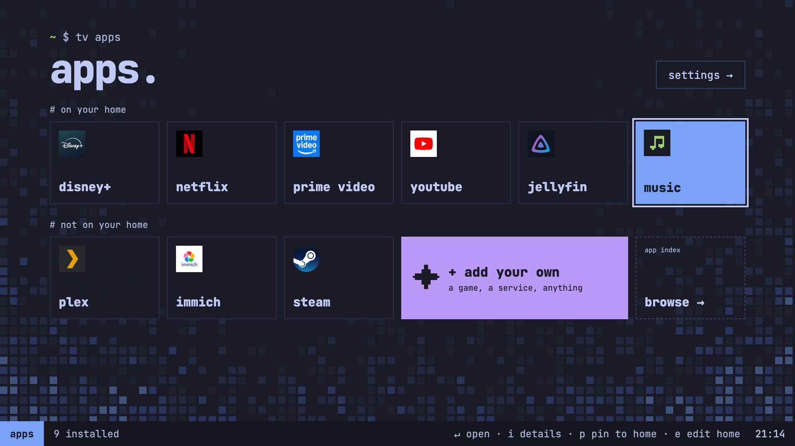
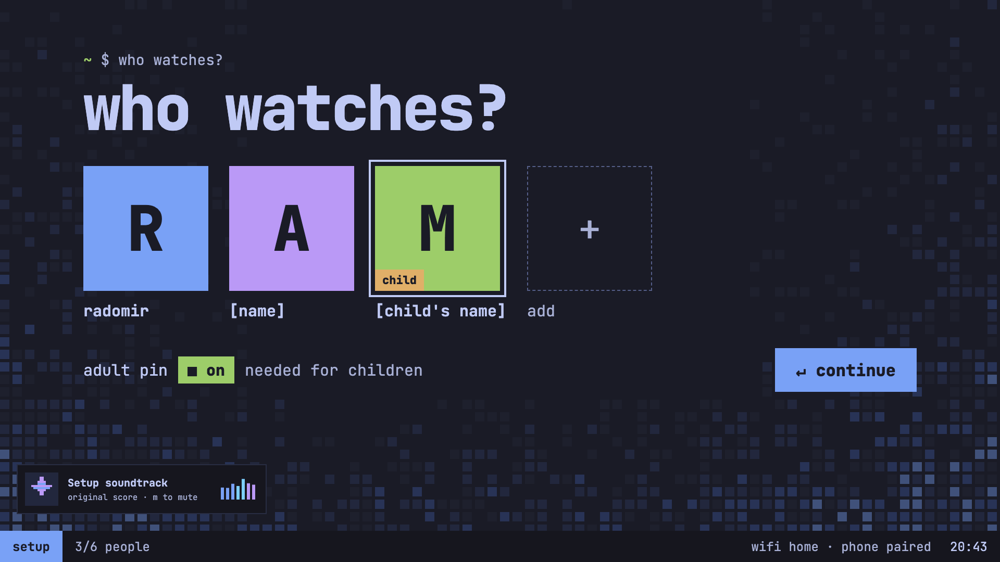
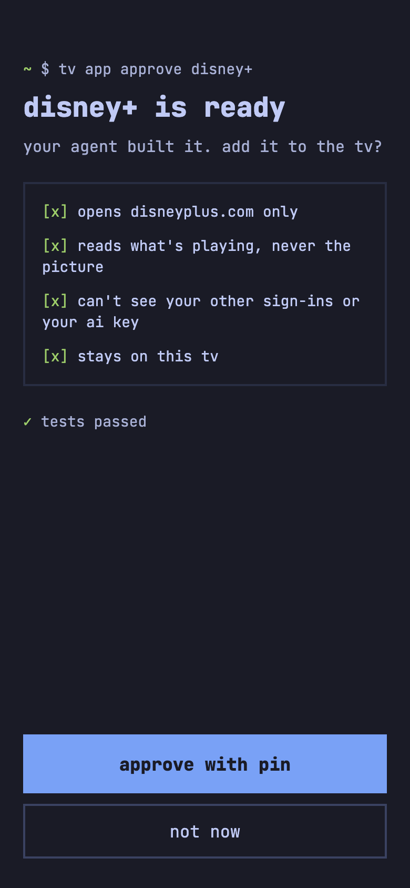
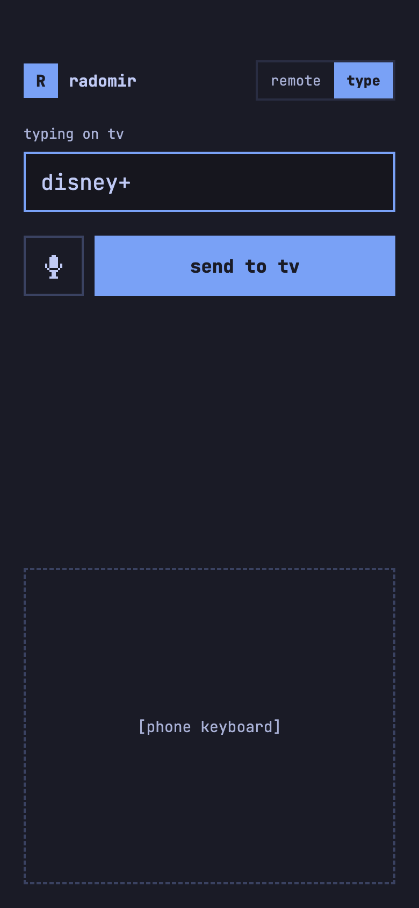
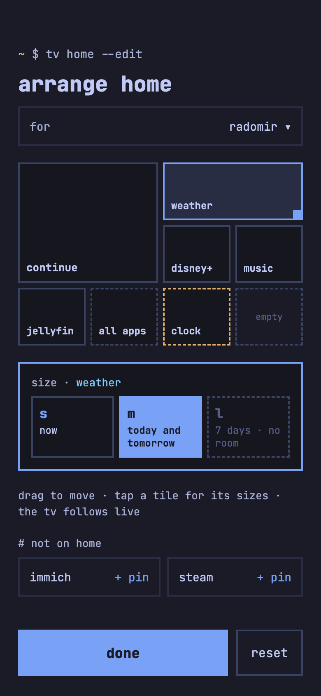

<p align="center">
  <picture>
    <source media="(prefers-color-scheme: dark)" srcset="../branding/logo.svg">
    
  </picture>
</p>

<p align="center">
  <b>The world's first open-source agentic TV OS.</b><br>
  Powered by <a href="https://omarchy.org">Omarchy</a>.
</p>

<p align="center">
  
</p>

---

AgenTV is the OS for a little box under your TV. Think of it as an Apple TV you own all the way down: one box, your phone as the remote, your apps, and a profile for everyone in the house.

It works with any TV that has HDMI. AgenTV runs on the box, not the TV, so it doesn't care if your TV is a Samsung, an LG or a Sony, or what it came with. A projector or an old monitor works too.

I wanted a TV I could just talk to. Sit down, say "continue the show I was watching" into your phone, and it knows which app that was.

And when an app is missing, you shouldn't have to wait for someone to write it. Ask for a streaming service or a game, and AgenTV's own agent builds the app on your box and tests it.

Underneath it's Omarchy, so the full Linux desktop is one switch away.

## What you get today

[0.1.4](https://github.com/radomird/agentv-os/releases/tag/v0.1.4) is out as a pre-release. It all passes its tests in a VM, and I'm still trying the new parts on my Intel NUC.

New in 0.1.4:

- **TV setup,** from "hi." to home. It asks where the TV is, which AI you use and who watches. Then it helps you pick your apps, a theme and a background.
- **An agent that builds the apps you're missing.** Ask for a streaming service, a game or a better weather app. It follows a recipe for each kind of app, builds it to AgenTV's rules for apps, and tests it. The app stays on your box unless you export it.
- **"Play" and a title,** said into your phone, across every app you have. Claude, ChatGPT, Gemini, Grok and Muse Code all work.
- **The TV answers out loud.** It uses your AI provider's own voice when the provider has one and you've given AgenTV a key. Otherwise it's Piper, a voice that runs right on the box.
- **What's new this week** on the services you have, and whether there's a new episode of your show yet. The list comes from TMDB, with a key from your own TMDB account. You add the key in _Settings > New this week_.
- **Every Omarchy theme on the TV,** with the theme's own backgrounds, or your photos and open art archives instead. Omarchy's terminal screensaver comes along too.
- **Share to the TV** from your phone: a link, a photo or a video.
- **Web apps made for a desktop** work with your phone's arrows too.

Already in 0.1.3:

- **Your phone is the remote.** Scan the code on the TV and your phone's browser becomes the remote and the keyboard. There's no app to install. It changes with what's on the TV: a PIN pad when the TV asks for your PIN, a keyboard for search, play and pause while something's on.
- **Continue** on home picks up what you were watching.
- **Your own media.** Music plays your own files, whether they're on the box, a USB drive or a share on your network. Jellyfin and Immich put your server's films and photos on the TV.
- **Steam Big Picture** runs full screen, and a game keeps running behind home.
- **Profiles for adults and children.** An adult picks which apps each child can see, and an adult PIN guards Settings, installs and Omarchy's desktop.
- **Settings from the couch.** Restart, shut down, pick the sound output and its volume, and choose your AI provider.
- **Signed updates.** Your box only installs packages signed with AgenTV's key. And before a release reaches you, it installs, boots and updates itself in a VM.

## What's coming

- **An iPhone app:** remote, keyboard and microphone in one.
- **A "Back to TV" button** on Omarchy's desktop.

| | |
| --- | --- |
|  |  |
|  |  |

<p align="center">
  
  
  
</p>

These are AgenTV's design screens. The TV is built to match them, so a few things in them are still coming soon. The posters and stills are from the Blender Foundation's open movies ([studio.blender.org](https://studio.blender.org), CC BY). Jellyfin's logo is the Jellyfin project's (CC BY-SA 4.0), and the other logos are their owners' (see [Trademarks](#trademarks)).

## Installing it

You'll need:

- an x86_64 box with HDMI (mine's an Intel NUC8i5BEH);
- a USB stick of 8 GB or more;
- a keyboard, for Omarchy's installer.

1. Download [the latest ISO](https://pub-18fa48b004b845838c98225b8955c7e6.r2.dev/iso/agentv-stable.iso) (about 6.6 GB), [its checksum](https://pub-18fa48b004b845838c98225b8955c7e6.r2.dev/iso/agentv-stable.iso.sha256) and [the checksum's signature](https://pub-18fa48b004b845838c98225b8955c7e6.r2.dev/iso/agentv-stable.iso.sha256.sig). [This file](https://pub-18fa48b004b845838c98225b8955c7e6.r2.dev/iso/agentv-stable.version) says which release it is. To check the download, put all three in one folder and run:

   ```
   curl -LO https://raw.githubusercontent.com/radomird/agentv-pkgs/main/agentv-keyring/agentv.gpg
   gpg --import agentv.gpg
   gpg --verify agentv-stable.iso.sha256.sig agentv-stable.iso.sha256
   sha256sum -c agentv-stable.iso.sha256
   ```

   The first two lines fetch AgenTV's public key. `gpg --verify` should say "Good signature", from the key `B4D4 7D67 1A03 84BF 7516 4CF1 AD68 7DD5 C049 475F`, and `sha256sum -c` should say the ISO is OK. On a Mac it's `shasum -a 256 -c`. [agentv-iso's README](https://github.com/radomird/agentv-iso#getting-the-iso) has the release candidate's ISO and last night's build too.
2. Write it to the stick with [balenaEtcher](https://etcher.balena.io/) on a Mac or Windows, or [caligula](https://github.com/ifd3f/caligula) on Linux, like [Omarchy's manual](../manual/02-getting-started.md) says.
3. Boot the box from the stick and answer Omarchy's usual installer questions. It wipes the box's disk.
4. The box reboots into AgenTV, and TV setup starts on the TV. Scan its code with your phone, and setup takes you the rest of the way to home.
5. Want another phone on it later? Pair it in _Settings > Phones_.

### Tested boxes

| Box | Release | How it went |
| --- | --- | --- |
| Intel NUC8i5BEH | 0.1.3 | Works. It's the box AgenTV is built on. |

Tried it on another box? [Tell me how it went](https://github.com/radomird/agentv-os/issues/new?template=box-report.yml) and I'll add it here.

## Questions

**Will it work with my TV?** If it has an HDMI input, yes. The TV only shows the picture and plays the sound, so its brand and its own OS don't matter.

**How is it different from OmarchyTV?** [OmarchyTV](https://github.com/piermark/omarchytv) by Marco Porro is a home screen in Omarchy's style for the TV you already have, on Android TV, Google TV and LG webOS. AgenTV is a whole OS on a box of its own, so it doesn't depend on what your TV runs. They'd get along fine: OmarchyTV on the TV, AgenTV on one of its HDMI inputs.

**Will streaming services play in 4K?** Not yet. They play in Chromium, and on Linux that means HD at best, with no HDR.

**Do I need an AI subscription?** Only for the agent and for "play": a key from one of the providers above, or a plan where its terms allow it. The rest works without one.

## Support AgenTV

AgenTV is free and open source. If it's useful to you and you'd like to help, you can [chip in through Stripe](https://buy.stripe.com/7sY4gzeMjdZs1oo7Wbgfu00) and pick the amount yourself. The checkout will say Indie AI Labs: that's where I build it.

A star helps too, and so does [telling me how it ran on your box](https://github.com/radomird/agentv-os/issues/new?template=box-report.yml).

## Powered by Omarchy

AgenTV is an Omarchy variant. It installs [Omarchy](https://omarchy.org) 4 and adds its own TV session next to Omarchy's desktop. Your box logs in to the TV, and when you want the full Linux desktop, you switch over to Omarchy's and back.

If you're poking around the code: this repo is a fork of [omacom/omarchy](https://github.com/omacom/omarchy) that follows Omarchy's stable releases. I never edit Omarchy's own files here. Everything AgenTV adds lives in its own folders: `install/tv/`, `session/`, `daemon/`, `launcher/`, `setup/`, `builder/`, `apps/`, `branding/`, and `bin/agentv`. Omarchy's own README is still here, at [`../README.md`](../README.md).

Omarchy is made by David Heinemeier Hansson and its contributors. It's MIT-licensed, its [licence](../LICENSE) stays as it is, and AgenTV's additions use the same licence. AgenTV isn't made or endorsed by the Omarchy project.

The AgenTV wordmark is drawn in the letters of Omarchy's logo, as a thank-you, and its "a" is Omarchy's own. `branding/build.py` makes every logo file from one set of letters.

## The AgenTV repos

| Repo | What it is |
| --- | --- |
| `agentv-os` (this one) | The TV OS itself: Omarchy, plus everything AgenTV adds |
| [`agentv-iso`](https://github.com/radomird/agentv-iso) | The installer: Omarchy's, set up to install AgenTV |
| [`agentv-pkgs`](https://github.com/radomird/agentv-pkgs) | The packages your box installs and updates from |
| [`agentv-apps`](https://github.com/radomird/agentv-apps) | The apps that come with AgenTV: Jellyfin, Immich, Steam and Plex |
| `agentv-plugin` | A "Back to TV" button for Omarchy's desktop (coming soon) |
| `agentv-companion` | The iPhone app: remote, keyboard and microphone in one (coming soon) |

## Trademarks

Apple TV, Disney+, Netflix, Prime Video, YouTube, Steam, Jellyfin, Immich, Plex, Samsung, LG and Sony are trademarks of their owners. I only name or show them to say which TVs and apps AgenTV works with. AgenTV isn't made or endorsed by any of them, and this repo has no code for Disney+, Netflix or Prime Video.
